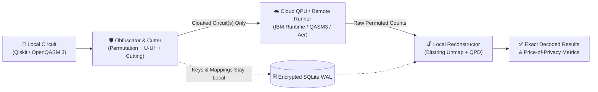

<div align="center">


<p align="center">
  
</p>

[](LICENSE)
[](https://www.python.org/)
[](https://www.ibm.com/quantum/qiskit)
[](https://fastapi.tiangolo.com/)
[](https://github.com/PelleNybe/qcloak-proxy/actions/workflows/ci.yml)
[](https://buymeacoffee.com/pellenybe)

<br />

[**📐 Architecture**](docs/ARCHITECTURE.md) • [**🔐 Privacy Model**](docs/PRIVACY_MODEL.md) • [**📡 API Reference**](docs/API_REFERENCE.md) • [**📘 User Manual**](docs/USER_MANUAL.md) • [**☕ Sponsor**](https://buymeacoffee.com/pellenybe)

</div>

---

## 🛡️ Why `qcloak-proxy`?

Every time you submit a quantum circuit to a third-party cloud QPU, the provider sees your **exact gate sequence, entanglement topology, circuit depth, and measurement layout**. High-value quantum intellectual property — variational ansatzes, financial/pharma oracles, and QML architectures — is exposed in plaintext before a single shot is executed.

**`qcloak-proxy`** places a **zero-trust cryptographic & structural privacy boundary** on your local machine:

- 🔐 **CSPRNG Wire & Register Permutation:** Cryptographically shuffles logical qubits ($S_n$) and classical readout bits ($S_m$) via `secrets.randbelow`, masking both circuit topology and output correlations.
- 🧩 **Neutralizing Gate Injection ($U \cdot U^\dagger = I$):** Injects random single-qubit Euler rotations and conjugated two-qubit entangling blocks ($\text{CX}/\text{CZ}$) with optional `Barrier` fencing — preserving the exact unitary while disguising depth and gate density.
- ✂️ **Multi-Backend Circuit Cutting:** Integrates `qiskit-addon-cutting` to automatically partition circuits into smaller subcircuits, dispatch them across heterogeneous backends, and reconstruct expectation values and probability distributions locally.
- 💾 **Encrypted Local-Only Key Custody:** All permutation keys, unmapping tables, and cutting quasi-probability coefficients remain strictly on your machine in a local **SQLite WAL** store with optional **Fernet (AES-128-CBC + HMAC-SHA256) encryption at rest** and one-call job key purging (`DELETE /jobs/{job_id}`).
- 🔍 **Embedded Web Dashboard & Dry-Run Audit:** Inspect outbound cloaked OpenQASM 3 via the built-in browser dashboard (`GET /`), `POST /obfuscate`, or `qcloak-proxy cloak` before anything leaves your network — and benchmark depth, 2Q-gate, TVD, and Hellinger fidelity trade-offs under realistic `qiskit-aer` noise models.
- ⚡ **1-Line Qiskit Drop-In (`BackendV2`):** Swap your backend with `QCloakProvider` and run existing Qiskit workflows without rewriting a single gate.

---

## 🏗️ Zero-Trust Architecture



---

## ⚡ Quickstart

### 1. 📦 Install
```bash
git clone https://github.com/PelleNybe/qcloak-proxy.git
cd qcloak-proxy
pip install -e .
```

### 2. 🚀 Launch the Local Privacy Proxy & Web Dashboard
```bash
qcloak-proxy serve --host 127.0.0.1 --port 8000 --privacy-profile medium
```
Then open **`http://127.0.0.1:8000/`** in your browser for the embedded **Circuit Cloaking Auditor, Price-of-Privacy Visualizer, and Local Key Vault** (zero extra dependencies), or **`http://127.0.0.1:8000/docs`** for Swagger OpenAPI.

### 3. 📊 Run a "Price of Privacy" Benchmark
```bash
qcloak-proxy benchmark --qubits 4 --shots 4096
```

---

## 🧪 Interactive Examples & Trade-Offs

<details>
<summary><b>⚡ 1-Line Qiskit Plugin Drop-In Example</b></summary>

```python
from qiskit import QuantumCircuit
from qcloak_proxy.provider import QCloakProvider

# 1-line drop-in replacement for any Qiskit BackendV2
with QCloakProvider("http://127.0.0.1:8000") as provider:
    backend = provider.get_backend("qcloak_aer")

    qc = QuantumCircuit(3, 3)
    qc.h(0)
    qc.cx(0, 1)
    qc.cx(1, 2)
    qc.measure([0, 1, 2], [0, 1, 2])

    # Obfuscated remotely, decoded locally, returned as a standard Qiskit Result
    job = backend.run(qc, shots=2048, privacy_profile="high")
    counts = job.result().get_counts()
    print("Decoded counts:", counts)
    print("Price of Privacy:", job.metrics(include_noise_sim=True))
```

</details>

<details>
<summary><b>📡 OpenQASM 3 REST API (<code>curl</code>) Example</b></summary>

```bash
# 1. Dry-run audit: inspect outbound cloaked OpenQASM 3 before sending anything
curl -s -X POST http://127.0.0.1:8000/obfuscate \
  -H "Content-Type: application/json" \
  -d '{
    "qasm3": "OPENQASM 3.0;\ninclude \"stdgates.inc\";\nqubit[2] q;\nbit[2] c;\nh q[0];\ncx q[0], q[1];\nc = measure q;",
    "privacy_profile": "high"
  }' | python3 -m json.tool

# 2. Submit an OpenQASM 3 Bell-state circuit through the proxy
JOB_ID=$(curl -s -X POST http://127.0.0.1:8000/submit \
  -H "Content-Type: application/json" \
  -d '{
    "qasm3": "OPENQASM 3.0;\ninclude \"stdgates.inc\";\nqubit[2] q;\nbit[2] c;\nh q[0];\ncx q[0], q[1];\nc = measure q;",
    "shots": 2048,
    "privacy_profile": "high"
  }' | python3 -c "import sys, json; print(json.load(sys.stdin)['job_id'])")

# 3. Retrieve locally decoded counts & probabilities
curl -s http://127.0.0.1:8000/result/$JOB_ID | python3 -m json.tool

# 4. Inspect Price-of-Privacy overhead & noisy Aer fidelity
curl -s "http://127.0.0.1:8000/metrics/$JOB_ID?include_noise_sim=true" | python3 -m json.tool
```

</details>

<details>
<summary><b>⚖️ Privacy vs. Noise Trade-Off Table</b></summary>

| Profile | Wire & Clbit Permutation | 1Q $U \cdot U^\dagger$ Density | 2Q Entangling Dummy Density | Barriers | Ideal Hellinger Fidelity | NISQ Noise Overhead |
| :--- | :---: | :---: | :---: | :---: | :---: | :--- |
| **`low`** | ✅ CSPRNG ($S_n \times S_m$) | `0.00` | `0.00` | ❌ | `> 0.999` | **Zero** (0 extra gates) |
| **`medium`** | ✅ CSPRNG ($S_n \times S_m$) | `0.25` | `0.00` | ✅ | `> 0.995` | **Low** (1Q depolarizing only) |
| **`high`** | ✅ CSPRNG ($S_n \times S_m$) | `0.50` | `0.20` | ✅ | `> 0.995` | **Moderate** (extra depth & 2Q) |

</details>

<details>
<summary><b>🖥️ Embedded Web Dashboard Features (<code>GET /</code>)</b></summary>

- **Circuit Cloaking Auditor:** Pre-loaded Bell, GHZ, and entangling presets or custom OpenQASM 3/2 input with side-by-side outbound cloaked QASM3 inspection.
- **Price-of-Privacy & Probability Visualizer:** Live depth/gate/2Q-gate deltas, ideal vs. noisy `qiskit-aer` Hellinger fidelity, and animated decoded bitstring probability bars.
- **Local SQLite Key Vault:** Browse job history, inspect decoded results, and purge local decoding keys with confirmation (`DELETE /jobs/{job_id}`).

</details>

---

## 🤝 Creators, Credits & Acknowledgments

`qcloak-proxy` is architected, engineered, and maintained with ❤️ by:

- **🏢 Organization:** [**Corax CoLAB**](https://coraxcolab.com) — *Deep Tech, Edge AI & Quantum Computing Innovation.*
- **👨‍💻 Lead Developer:** **Pelle** ([GitHub: `@PelleNybe`](https://github.com/PelleNybe))
- **🙏 Acknowledgments:** Built on top of the open-source [**Qiskit**](https://www.ibm.com/quantum/qiskit), **`qiskit-aer`**, **`qiskit-addon-cutting`**, and [**FastAPI**](https://fastapi.tiangolo.com/) ecosystems.

### ☕ Support the Project

If `qcloak-proxy` helps protect your quantum research or workflows, consider sponsoring its continued development:

<a href="https://buymeacoffee.com/pellenybe" target="_blank">
  
</a>

👉 **[https://buymeacoffee.com/pellenybe](https://buymeacoffee.com/pellenybe)**

---

## 📄 License

Licensed under the **Apache License 2.0**. See [LICENSE](LICENSE) for details.
