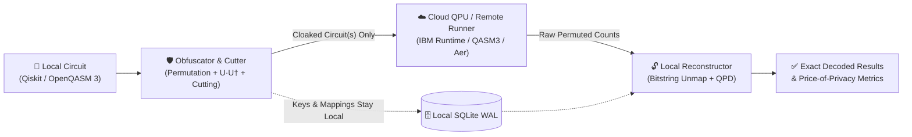

<div align="center">

# 🛡️ `qcloak-proxy`

**Zero-Trust Privacy Proxy for Cloud-Based Quantum Computers**

[](LICENSE)
[](https://www.python.org/)
[](https://www.ibm.com/quantum/qiskit)
[](https://fastapi.tiangolo.com/)
[](https://github.com/PelleNybe/qcloak-proxy/actions/workflows/ci.yml)

*Protect your proprietary quantum algorithms, circuit topologies, and intellectual property on untrusted cloud QPUs — with a 1-line Qiskit drop-in.*

[Architecture](docs/ARCHITECTURE.md) • [Privacy Model](docs/PRIVACY_MODEL.md) • [API Reference](docs/API_REFERENCE.md) • [User Manual](docs/USER_MANUAL.md)

</div>

---

## 🚀 Why `qcloak-proxy`?

When you submit a quantum circuit to a third-party cloud QPU, the provider sees your **exact gate sequence, qubit entanglement graph, circuit depth, and measurement layout** — exposing high-value quantum IP (variational ansatzes, financial/pharma oracles, QML architectures) to potential inspection or reverse-engineering.

**`qcloak-proxy`** solves this with a local, zero-trust privacy boundary:

- 🔐 **CSPRNG Wire & Register Permutation:** Cryptographically shuffles logical qubits ($S_n$) and classical readout bits ($S_m$) via `secrets.randbelow`, masking both circuit topology and output correlations.
- 🧩 **Neutralizing Gate Injection ($U \cdot U^\dagger = I$):** Injects random single-qubit Euler rotations and conjugated two-qubit entangling blocks ($\text{CX}/\text{CZ}$) with optional barrier fencing — preserving the exact unitary while disguising depth and gate density.
- ✂️ **Multi-Backend Circuit Cutting:** Integrates `qiskit-addon-cutting` to automatically partition circuits into smaller subcircuits, dispatch them across heterogeneous backends, and reconstruct expectation values and probability distributions locally.
- 💾 **Encrypted Local-Only Key Custody:** All permutation keys, unmapping tables, and cutting quasi-probability coefficients remain strictly on your machine in a local **SQLite WAL** store with optional **Fernet (AES-128-CBC + HMAC-SHA256) encryption at rest** and one-call job key purging (`DELETE /jobs/{job_id}`).
- 🔍 **Dry-Run Audit & Price-of-Privacy Metrics:** Inspect outbound cloaked OpenQASM 3 via `POST /obfuscate` or `qcloak-proxy cloak` before anything leaves your network, and benchmark depth, 2Q-gate, TVD, and Hellinger fidelity trade-offs under realistic `qiskit-aer` noise models.
- ⚡ **1-Line Qiskit Drop-In (`BackendV2`):** Swap your backend with `QCloakProvider` and run existing Qiskit workflows without rewriting a single gate.

---

## 🏗️ Architecture



---

## ⚡ Quickstart

### 1. Install
```bash
git clone https://github.com/PelleNybe/qcloak-proxy.git
cd qcloak-proxy
pip install -e .
```

### 2. Launch the Local Privacy Proxy
```bash
qcloak-proxy serve --host 127.0.0.1 --port 8000 --privacy-profile medium
```

### 3. Run a "Price of Privacy" Benchmark
```bash
qcloak-proxy benchmark --qubits 4 --shots 4096
```

---

## 🧪 Interactive Examples & Trade-Offs

<details>
<summary><b>1-Line Qiskit Plugin Drop-In Example</b></summary>

```python
from qiskit import QuantumCircuit
from qcloak_proxy.provider import QCloakProvider

# 1-line drop-in replacement for any Qiskit BackendV2
backend = QCloakProvider("http://127.0.0.1:8000").get_backend("qcloak_aer")

qc = QuantumCircuit(3, 3)
qc.h(0)
qc.cx(0, 1)
qc.cx(1, 2)
qc.measure([0, 1, 2], [0, 1, 2])

# Obfuscated remotely, decoded locally, returned as a standard Qiskit Result
counts = backend.run(qc, shots=2048, privacy_profile="high").result().get_counts()
print(counts)
```

</details>

<details>
<summary><b>OpenQASM 3 REST API (<code>curl</code>) Example</b></summary>

```bash
# 1. Submit an OpenQASM 3 Bell-state circuit
JOB_ID=$(curl -s -X POST http://127.0.0.1:8000/submit \
  -H "Content-Type: application/json" \
  -d '{
    "qasm3": "OPENQASM 3.0;\ninclude \"stdgates.inc\";\nqubit[2] q;\nbit[2] c;\nh q[0];\ncx q[0], q[1];\nc = measure q;",
    "shots": 2048,
    "privacy_profile": "high"
  }' | python3 -c "import sys, json; print(json.load(sys.stdin)['job_id'])")

# 2. Retrieve locally decoded counts & probabilities
curl -s http://127.0.0.1:8000/result/$JOB_ID | python3 -m json.tool

# 3. Inspect Price-of-Privacy overhead & noisy Aer fidelity
curl -s "http://127.0.0.1:8000/metrics/$JOB_ID?include_noise_sim=true" | python3 -m json.tool
```

</details>

<details>
<summary><b>Privacy vs. Noise Trade-Off Table</b></summary>

| Profile | Wire & Clbit Permutation | 1Q $U \cdot U^\dagger$ Density | 2Q Entangling Dummy Density | Barriers | Ideal Hellinger Fidelity | NISQ Noise Overhead |
| :--- | :---: | :---: | :---: | :---: | :---: | :--- |
| **`low`** | ✅ CSPRNG ($S_n \times S_m$) | `0.00` | `0.00` | ❌ | `> 0.999` | **Zero** (0 extra gates) |
| **`medium`** | ✅ CSPRNG ($S_n \times S_m$) | `0.25` | `0.00` | ✅ | `> 0.995` | **Low** (1Q depolarizing only) |
| **`high`** | ✅ CSPRNG ($S_n \times S_m$) | `0.50` | `0.20` | ✅ | `> 0.995` | **Moderate** (extra depth & 2Q) |

</details>

---

## 🤝 Creators & Credits

`qcloak-proxy` is engineered and maintained by:

- **Organization:** [**Corax CoLAB**](https://coraxcolab.com/) — *Deep Tech, Edge AI & Quantum Computing Innovation.*
- **Lead Developer:** **Pelle Nyberg** ([GitHub: `@PelleNybe`](https://github.com/PelleNybe))

---

## 📄 License

Licensed under the **Apache License 2.0**. See [LICENSE](LICENSE) for details.
