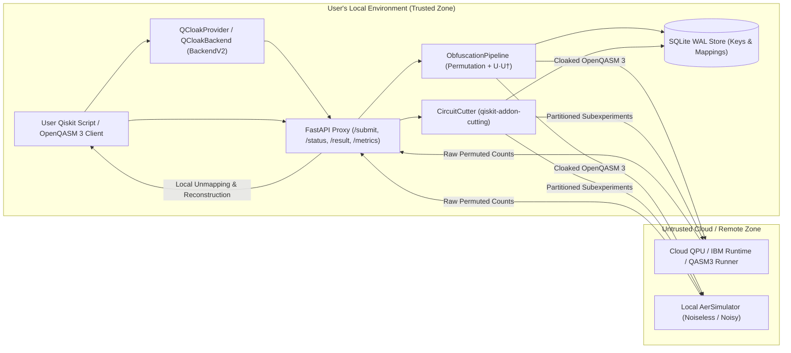

# Architecture Overview — `qcloak-proxy`

**`qcloak-proxy`** is a local, zero-trust Quantum Privacy Proxy designed by **Corax CoLAB** to isolate proprietary quantum algorithms from untrusted cloud quantum backends.

---

## System Topology

---

## Component Responsibilities

### 1. Obfuscation Engine (`src/qcloak_proxy/obfuscation/`)
- **`permutation.py` (`QubitPermutationPass`)**: Rewires logical qubits $q_i \mapsto q_{\pi(i)}$ and classical bits $c_j \mapsto c_{\sigma(j)}$ using Fisher-Yates shuffles backed by `secrets.randbelow`. Includes `unmap_bitstring` and `unmap_counts` for exact big-endian multi-register restoration.
- **`dummy_gates.py` (`DummyGatesPass`)**: Inserts neutralizing single-qubit Euler blocks $U(\theta,\phi,\lambda) \cdot U^\dagger$ and conjugated two-qubit entangling blocks ($\text{CX}$ / $\text{CZ}$ pairs) with optional `Barrier` fences.
- **`pipeline.py` (`ObfuscationPipeline`)**: Composes passes into a Qiskit `PassManager` according to `low`, `medium`, or `high` privacy profiles and produces a serializable `ObfuscationKeyBundle`.
- **`cutter.py` (`CircuitCutter`)**: Integrates `qiskit-addon-cutting` (`find_cuts`, `cut_wires`, `partition_problem`, `generate_cutting_experiments`, `reconstruct_expectation_values`) to split circuits across multiple backends and reconstruct expectation values or full Z-basis probability distributions via Walsh-Hadamard + simplex projection.

### 2. Backend Adapters (`src/qcloak_proxy/backends/`)
- **`base.py` (`QuantumBackendAdapter`)**: Async interface (`submit`, `status`, `result`, `cancel`, `close`).
- **`local_aer.py` (`LocalAerBackend`)**: Executes circuits on `qiskit_aer.AerSimulator` with optional superconducting-like depolarizing + readout error `NoiseModel`.
- **`cloud_client.py` (`CloudQuantumClient`)**: Production `httpx.AsyncClient` with HTTP/2, TLS verification, Bearer auth, and exponential-backoff retries for IBM Quantum Runtime and generic OpenQASM 3 HTTP runners.

### 3. FastAPI Server & SQLite WAL Store (`src/qcloak_proxy/server/`)
- **`state_store.py` (`LocalStateStore`)**: SQLite database in `WAL` mode storing `original_qasm`, `obfuscated_qasm`, `key_bundle`, `cutting_metadata`, `raw_counts`, `decoded_counts`, and `metrics` strictly on the local disk.
- **`api.py`**: Exposes `/health`, `/submit`, `/status/{job_id}`, `/result/{job_id}`, `/metrics/{job_id}`, and `/jobs`.

### 4. Qiskit Plugin & Metrics (`src/qcloak_proxy/provider/`, `src/qcloak_proxy/metrics.py`)
- **`QCloakProvider` / `QCloakBackend` (`BackendV2`) / `QCloakJob` (`JobV1`)**: 1-line drop-in replacement for Qiskit scripts.
- **`metrics.py`**: Quantifies the "Price of Privacy" (depth overhead, gate/2Q-gate overhead, cutting sampling overhead, TVD, Hellinger fidelity, KL divergence, and noisy Aer degradation).
